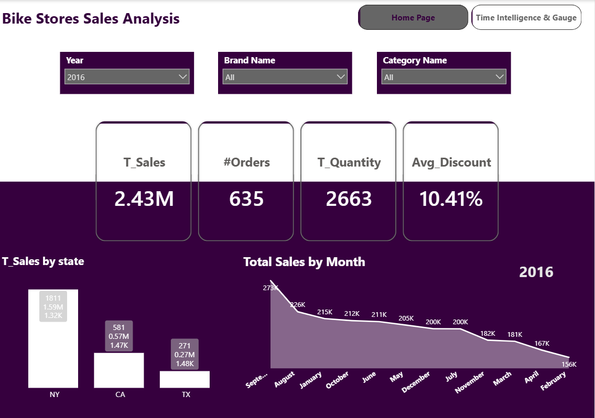
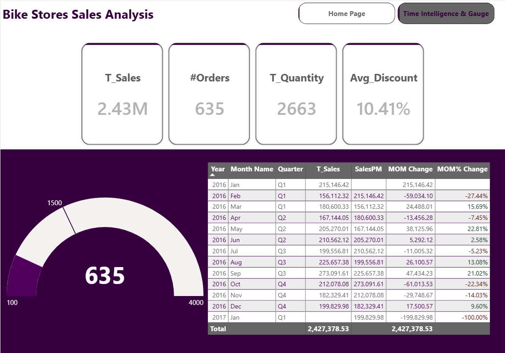
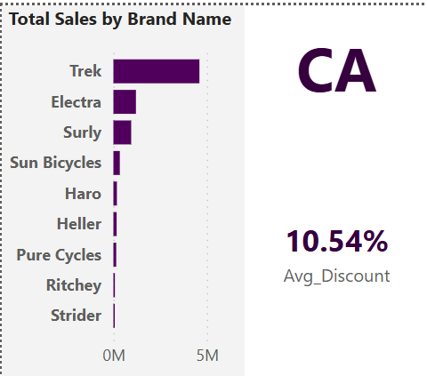
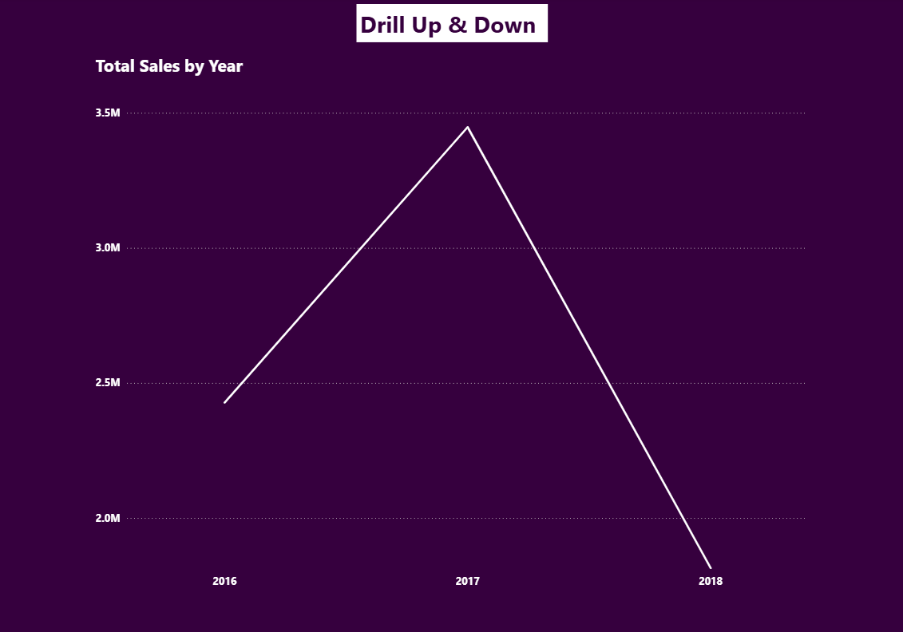
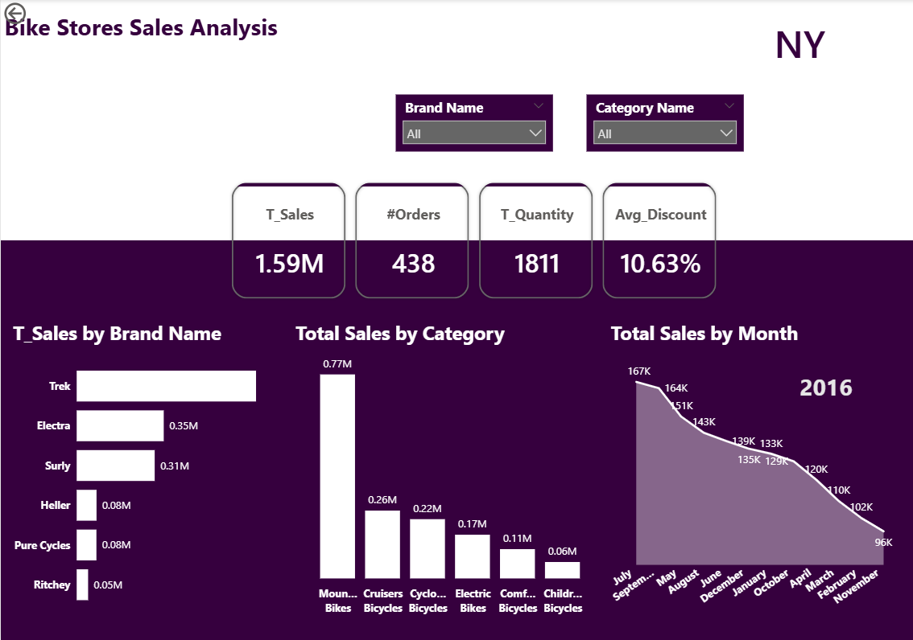
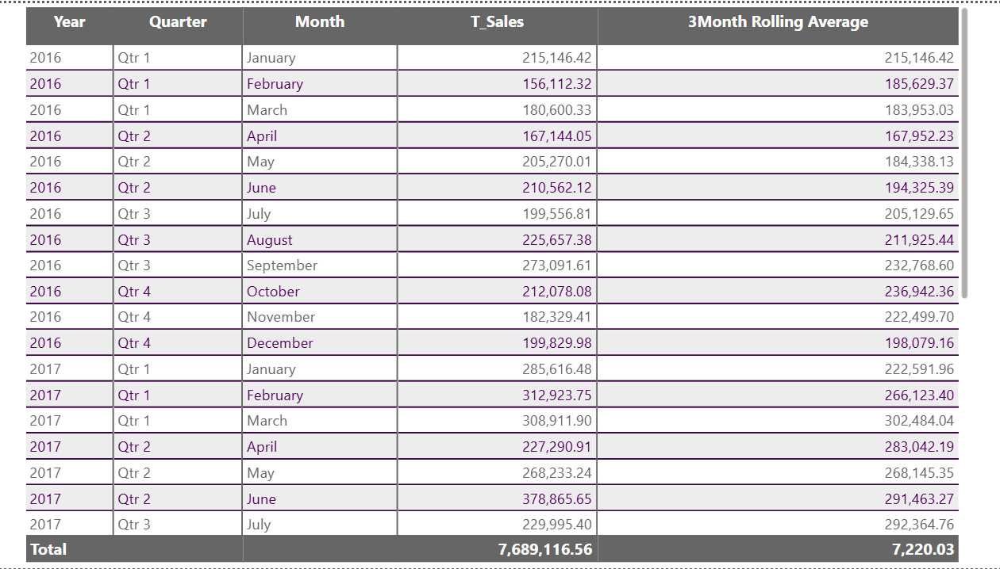
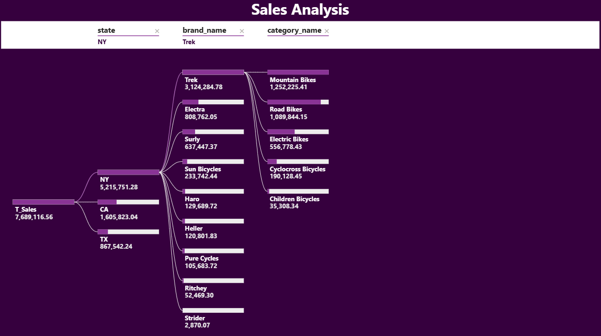

# Bike Stores Sales Analysis | Power BI Dashboard

An advanced Power BI practice project: a 7-page interactive report analyzing bike store sales (2016–2018) segmented by **state**, **brand**, and **category**.

## Key Techniques
- Time intelligence (Month-over-Month change, MoM %, previous-month sales)
- DAX 3-month rolling average
- Drillthrough page (state-level deep dive)
- Drill up/down hierarchy (Year → Quarter → Month)
- Decomposition tree (State → Brand → Category)
- Tooltip page and gauge visual
- Dynamic slicers (Year, Brand, Category) and page navigation buttons

## Key Measures
`T_Sales` · `#Orders` · `T_Quantity` · `Avg_Discount` · `SalesPM` · `MOM Change` · `MOM% Change` · `3Month Rolling Average`

## Dashboard Preview

### 1. Home Page
KPI cards, slicers, sales by state, and monthly sales trend.

### 2. Time Intelligence & Gauge
Month-over-month analysis table with a gauge for total orders.

### 3. Tooltip Page
Brand sales breakdown and average discount shown on hover.

### 4. Drill Up & Down
Yearly sales trend with drill-down capability.

### 5. Drillthrough Page (State Level)
Detailed view per state: sales by brand, category, and month.

### 6. 3-Month Rolling Average
Monthly sales smoothed with a DAX rolling average.

### 7. Decomposition Tree
Root-cause style breakdown of sales by state, brand, and category.

## Tools
Power BI Desktop, DAX, Power Query

## Files
- `Bike_Stores_Sales_Analysis.pbix` – the Power BI report
- `screenshots/` – preview of each report page

## How to Open
Download the `.pbix` file and open it with Power BI Desktop.
